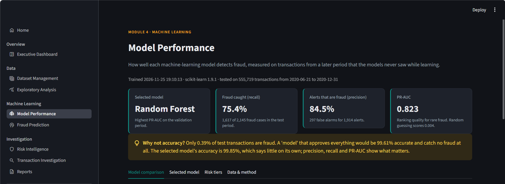
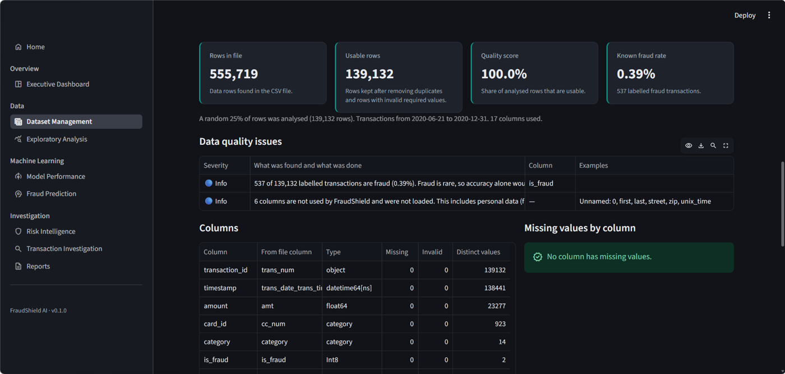
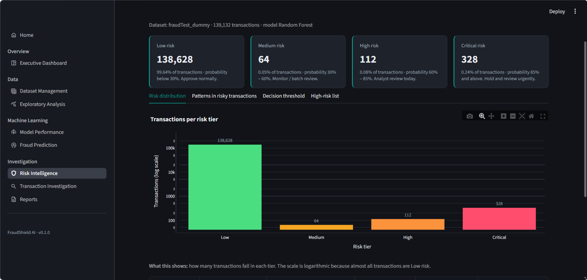
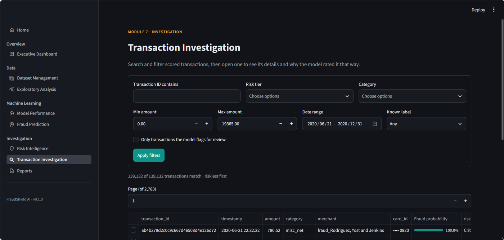
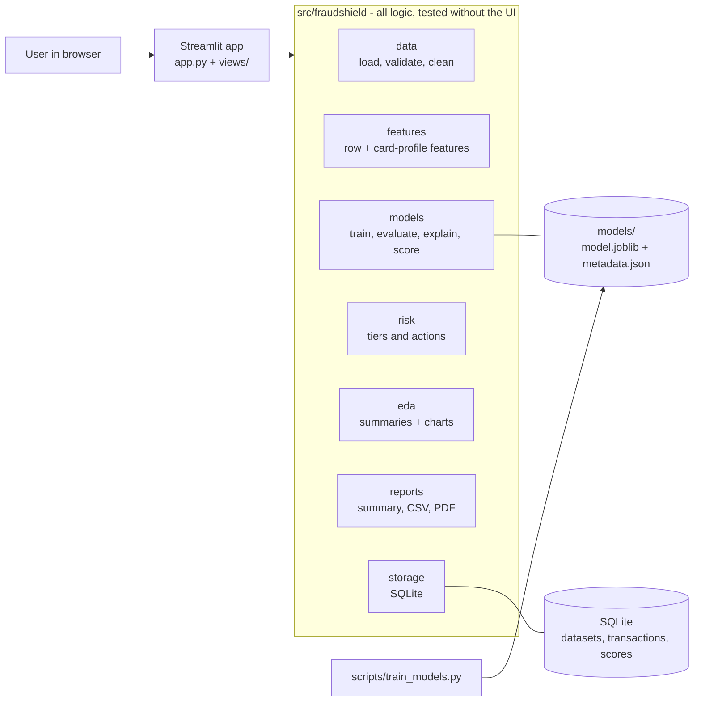
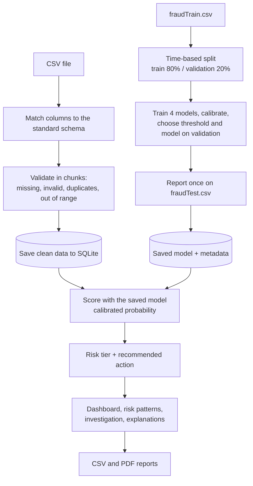

# FraudShield AI

**An end-to-end machine-learning platform that finds suspicious card transactions, explains
why they look risky, and tells an analyst what to review first.**

[](https://github.com/Kalai-coder-DS/FraudShield-AI/actions/workflows/tests.yml)




> Fraud probabilities are model estimates based on past patterns. They help decide which
> transactions to review first; they are not confirmed fraud decisions.

---

## Results at a glance

Measured once on **555,719 transactions (Jun–Dec 2020) that the model never saw while
learning**; 2,145 of them (0.39%) are fraud.

| | Random Forest (selected) |
|---|---|
| Fraud caught (recall) | **75.4%** — 1,617 of 2,145 fraud cases |
| Alerts that are real fraud (precision) | **84.5%** — 297 false alarms in 1,914 alerts |
| PR-AUC | **0.823** (random guessing: 0.004) |
| ROC-AUC | 0.994 |
| Calibration | Medium / High / Critical tiers contain 36% / 76% / 94% fraud — in line with their 30–60% / 60–85% / 85%+ probability ranges |

Why not accuracy? Approving *every* transaction would already be 99.61% accurate and catch
no fraud at all. FraudShield judges models by precision, recall and PR-AUC instead.

**What the data shows:** the typical fraud transaction is about **10× larger** than a normal
one, fraud is **5× more likely around 22:00–23:00**, and online shopping is **4× more
common** among high-risk transactions than overall.

---

## What it does

| Module | What a user can do |
|---|---|
| **Executive Dashboard** | One screen for managers: transactions checked, value flagged, high-risk count, weekly trend, risky categories and plain-language findings |
| **Dataset Management** | Load the bundled sample, upload a CSV or use a large local file; columns are matched automatically; every data problem is found, explained and handled |
| **Exploratory Analysis** | Fraud vs. legitimate patterns by amount, time, category and customer, with 95% confidence intervals |
| **Model Performance** | Compare four models on unseen data: PR/ROC curves, confusion matrix, risk-tier check, feature importance |
| **Fraud Prediction** | Score one transaction (from the data or typed in) and see *why* — which details raised or lowered the score |
| **Risk Intelligence** | Low / Medium / High / Critical tiers with actions, patterns among risky transactions, and a threshold slider showing the catch-vs-false-alarm trade-off |
| **Transaction Investigation** | Filter and search all scored transactions; click one for its full explanation |
| **Reports** | Download scored transactions (CSV, card numbers masked) and a 2–3 page PDF report |

| Data quality check | Risk tiers | Investigation |
|---|---|---|
|  |  |  |

---

## How it works

### Architecture



The UI only displays results. Everything that calculates something lives in the
`fraudshield` package and is covered by automated tests.

### Workflow



### Machine-learning design (the short version)

- **Time-based split.** Train on Jan 2019 – Mar 2020, validate on Mar – Jun 2020, test on
  Jun – Dec 2020. The model is always judged on the future, never on the past.
- **No data leakage.** Imputation, scaling, encoding and the per-card spending profile are
  learned inside one scikit-learn `Pipeline` from the training period only.
- **Rare fraud.** Balanced class weights, then isotonic **calibration** on validation data so
  that "70%" really means about 70%.
- **Honest selection.** Model and decision threshold are chosen on validation data; the
  test set is used once, for reporting.
- **Explainable.** Each score is broken down per feature by replacing that feature with
  typical values and re-scoring (a simple, model-agnostic cousin of SHAP).
- **Responsible.** Gender, job and other sensitive or high-cardinality fields are not given
  to the model; card numbers are masked everywhere; personal columns are never loaded.

Details: [docs/models.md](docs/models.md) · [model card](docs/model_card.md).

---

## Getting started

**Requirements:** Python 3.10 or newer, Git, about 1 GB of free RAM (2 GB for full training).

```bash
git clone https://github.com/Kalai-coder-DS/FraudShield-AI.git
cd FraudShield-AI

python -m venv .venv
# Windows (PowerShell):   .venv\Scripts\activate
# macOS / Linux:          source .venv/bin/activate

pip install -r requirements-dev.txt
```

On Windows, if `python` opens an old version, create the environment with
`py -3 -m venv .venv` instead.

### 1. Get the data

Download the **Credit Card Transactions Fraud Detection Dataset** from Kaggle
(kartik2112/fraud-detection) and put `fraudTrain.csv` and `fraudTest.csv` in `data/raw/`.
The 50,000-row sample in `data/sample/` is already included, so the app works without this
step except for training.

### 2. Train the models (1–3 minutes)

```bash
python scripts/train_models.py            # add --train-fraction 0.3 on a low-memory laptop
```

### 3. Run the app

```bash
streamlit run app.py
```

Open http://localhost:8501 and click **Load sample dataset** on any page.

### 4. Run the tests

```bash
pytest                                  # about 190 tests, ~1 minute
pytest --cov --cov-report=term          # with coverage (98% of the code)
ruff check .                            # code quality
python scripts/benchmark.py             # speed and memory on your computer
```

---

## Project structure

```
FraudShield-AI/
├── app.py                  # entry point: theme, sidebar navigation
├── views/                  # one Streamlit page per module (display only)
├── src/fraudshield/
│   ├── config.py           # paths, seed, risk thresholds
│   ├── data/               # schema, chunked loader, validation, sample loader
│   ├── features/           # row features, card profile (leak-free)
│   ├── eda/                # EDA summaries and Plotly charts
│   ├── models/             # training, evaluation, registry, scoring, explanations
│   ├── risk/               # risk tiers and actions
│   ├── reports/            # shared summary, CSV and PDF
│   ├── storage/            # SQLite: datasets, transactions, scores
│   └── ui/                 # theme, components, shared page helpers
├── scripts/                # make_sample, train_models, benchmark
├── data/sample/            # 50k-row stratified sample (committed)
├── models/metadata.json    # results of the trained model (model file itself is git-ignored)
├── tests/                  # unit, integration and UI flow tests
└── docs/                   # requirements, dataset, EDA, models, prediction, reports, testing
```

---

## Tech stack

| Layer | Choice | Why |
|---|---|---|
| Language | Python | Standard for data science |
| Data | pandas, NumPy | Chunked, typed processing |
| ML | scikit-learn | Pipelines, four models, calibration, metrics |
| App | Streamlit | One lightweight process, no separate frontend |
| Charts | Plotly (app), Matplotlib (PDF) | Interactive in the app, static in print |
| Storage | SQLite | Built into Python; paginated tables without loading everything into memory |
| Reports | ReportLab | PDF built from the same summary as the dashboard |
| Quality | pytest, pytest-cov, Ruff, GitHub Actions | Tests run on every push |

---

## Documentation

| Document | Contents |
|---|---|
| [docs/requirements.md](docs/requirements.md) | Requirements specification (Phase 0) |
| [docs/dataset.md](docs/dataset.md) | Data source, schema, validation rules, performance |
| [docs/eda.md](docs/eda.md) | Exploratory analysis methods |
| [docs/models.md](docs/models.md) | Training workflow, models, features, metrics |
| [docs/model_card.md](docs/model_card.md) | Intended use, results, limitations of the trained model |
| [docs/prediction.md](docs/prediction.md) | Scoring, risk tiers, explanations, investigation |
| [docs/reports.md](docs/reports.md) | Dashboard, CSV and PDF |
| [docs/testing.md](docs/testing.md) | Test strategy, bugs found, manual checklist, benchmarks |
| [docs/interview_guide.md](docs/interview_guide.md) | Design decisions explained, question by question |
| [CHANGELOG.md](CHANGELOG.md) | Version history |

---

## Limitations

- **Synthetic data.** The Sparkov dataset is simulated; real fraud is messier and changes
  over time. Results here are an upper bound for what to expect in production.
- **Static model.** It does not learn from analyst feedback yet and has no drift monitoring.
- **Single user, no login.** Intended as a local analysis tool, not a multi-user service.
- **Illustrative thresholds.** Risk-tier cut-offs are documented and configurable, not
  regulatory guidance.
- **Approximate explanations.** Feature contributions are an approximation for non-linear
  models.

## Future improvements

Analyst feedback loop and periodic retraining · data and score drift monitoring ·
gradient-boosted models and SHAP explanations · real-time scoring API · user accounts and
roles · graph features (shared merchants and devices).

## License

MIT — see [LICENSE](LICENSE). The Kaggle dataset has its own licence; see
[docs/dataset.md](docs/dataset.md).
